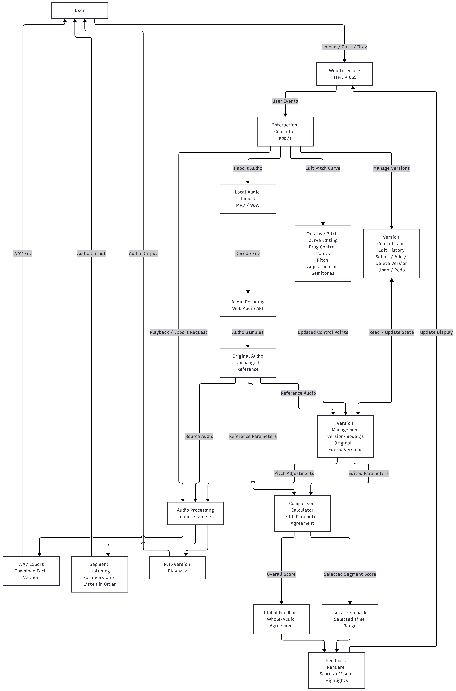
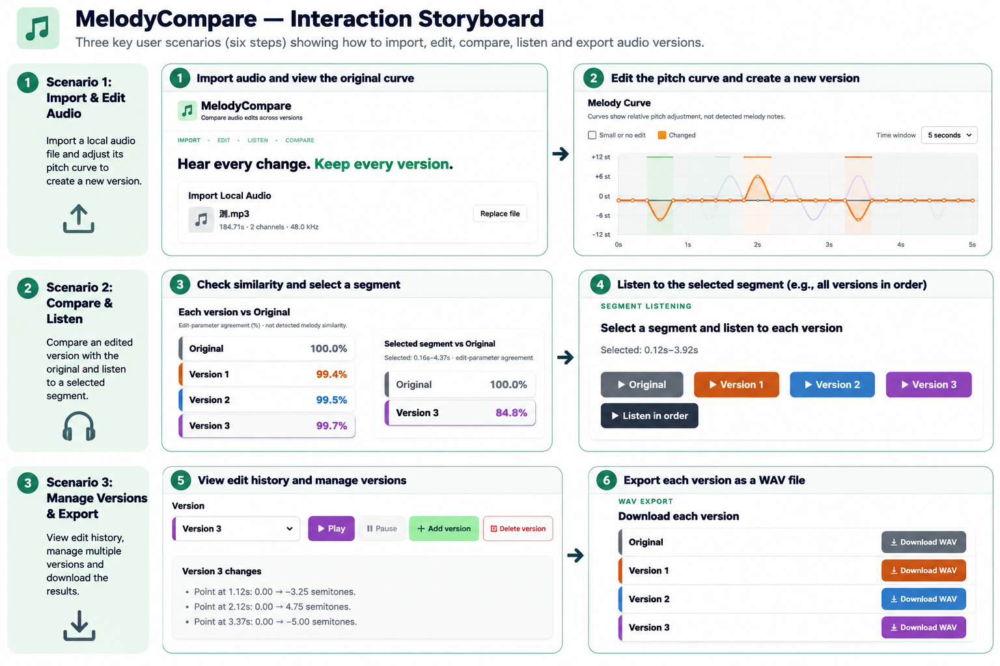

# MelodyCompare

**Melody Comparison and Version-Based Audio Editing** is a browser prototype for comparing edits to one imported recording. Users adjust a relative pitch curve, immediately save or delete numbered versions, listen to the same time range in each version, and download the resulting audio. The Original stays unchanged.

The page uses HTML, CSS, JavaScript and Web Audio API. No server, database, external library, API key or AI model is required.

## Run and use

Open [index.html](index.html) in a current Windows Chrome or Edge browser. If your browser restricts local decoding, open the same project with VS Code Live Server. Import a browser-decodable WAV or MP3 of up to **50 MB / five minutes**. Processing stays in the browser tab; refreshing or replacing the source starts a new session.

1. Choose **Original** or a saved **Version 1**, **Version 2**, etc. The selected curve and Play button share a color. Play and Pause control the actual audio. The native audio bar can resume a paused version.
2. The version change list, pitch-point controls and segment tools stay visible together. Click a point on a numbered curve to select it, then use the pitch slider, or drag anywhere along that curve to adjust its nearest control point. A click without a change leaves the version as it was. Pitch, volume and speed changes to a numbered version save to **that version automatically**; Undo/Redo can recover earlier values. Original remains unchanged. Editing Original creates an unsaved numbered edit until Add version is clicked.
3. Click **Add version** to create and immediately save a new numbered version. Without a pending edit, it starts from Original’s flat adjustment curve and settings, even when another numbered version is selected. The new version is selected and ready to edit; no “unsaved” entry appears just from adding or clicking it. If audio processing is still running, Add version waits for it and then saves.
4. Drag an empty area of the curve, or hold **Shift** while dragging across a control point, to select a time span. The segment buttons play that same output-time span in each available version. **Listen in order** prepares all selected segments first, then plays one continuous WAV stream with no media reload between versions. The selected curve and playback pointer follow the current version; Pause and the native audio bar work on the combined stream. A shorter version is silent past its end. The selected-range comparison box always stays visible and explains how to select a range until one is chosen. Volume and Speed remain in the segment tools.
5. Each saved version has a separate **Download WAV** button. A temporary unsaved edit can also be downloaded. These files contain the actual processed 16-bit PCM audio, not a renamed original.
6. Select a numbered version and click **Delete version** to remove that saved snapshot from the curve, picker, scores, listening buttons and downloads. Original cannot be deleted. Deletion cannot be reversed with Undo/Redo; these buttons continue to recover edits, not deleted snapshots. Version numbers are not reused.

## What the curve and score mean

The Original grey curve is **zero relative pitch adjustment**. Colored curves represent adjustments applied by the user. They are **not** detected notes or a pitch contour extracted from MP3. This prototype does not transcribe polyphonic music.

The whole-audio score list compares **each version separately with Original**. A second, always-visible box compares only the selected interval using the same rule. Before a valid range is selected, it displays selection instructions instead of a percentage. It measures edit-parameter agreement, not musical or perceptual similarity. The longer output timeline is split into **20 ms bins**. A bin agrees when both versions contain audio, effective pitch adjustment differs by at most **0.25 semitones** (including the pitch effect of speed), retained-source positions differ by at most **2 ms**, and gain differs by at most **0.01**. Score = agreeing duration ÷ compared duration × 100, rounded to one decimal. A volume change can lower this score even when the notes stay the same. The interface intentionally displays only the per-version data, without a detailed region list.

## Version and audio implementation

A numbered version contains an ID, display name, colour, creation time, editing state and change summary. Each version maintains an independent editing state, including relative pitch control points and audio settings. The Add version function creates a saved version based on the Original or a pending edit. Subsequent changes to a numbered version update that version without modifying the Original audio. Undo and Redo allow users to reverse and reapply supported editing operations. Deleting a version removes its saved state without affecting the Original or other versions. Rendered audio may be cached to support repeated playback.

Pitch points use smoothstep interpolation. For changed intervals, the audio engine applies a whole-arrangement overlap-add renderer with overlapping Hann grains and bounded waveform alignment. Unchanged intervals now copy the source directly instead of running the granular processor over the entire recording. This makes a local pitch edit faster while keeping unchanged samples and preserving the existing transition behavior. Processed playback and downloads use rendered samples. Large or rapid pitch shifts and complex/polyphonic audio can still sound grainy or smeared; this is not professional pitch shifting.

To reduce interface pauses, the controller no longer rebuilds a dropdown containing thousands of control points, caches per-version comparison results until state changes, uses the imported File's native playback URL for the full Original when available, and reuses small encoded WAV blobs for repeated saved-version playback. The WAV blob cache holds at most two files and only files up to 24 MB. Listen in order now pre-renders each selected segment and concatenates the PCM into one WAV, with a 5 ms fade at version boundaries to limit clicks. It has a 96 MB combined PCM preparation limit; choose a shorter segment if the page asks. Preparation can take time on a long edit, but version changes during playback no longer trigger audio rendering, WAV encoding or media reload. The first playback/export of a large edited version can still take time because the browser must render or encode it.

A representative **Node VM benchmark** on this machine used an eight-second, 44.1 kHz mono tone with one local +2-semitone control point: rendering took approximately **2.5 seconds before** the interval optimization and **about 0.5 seconds after**. This is a narrow synthetic measurement, not a browser-wide guarantee. Whole-recording pitch shifts, long stereo recordings, decoding and first-time WAV export may still be slow. Long sample loops yield to the browser every 32,768 frames so controls can respond during processing; this can slightly increase total render time.

## Files and tests

| File | Purpose |
| --- | --- |
| [index.html](index.html) | Import, numbered version chooser, curve, segment tools, comparison lists and downloads |
| [style.css](style.css) | Compact responsive layout and version colors |
| [app.js](app.js) | Import, editing controls, playback, score caching, version creation/deletion and WAV encoding |
| [audio-engine.js](audio-engine.js) | Curve-based real audio processing and local-interval optimization |
| [version-model.js](version-model.js) | Snapshot history, deletion, whole/selected-range comparison and Undo/Redo |
| [tests/](tests/) | Numerical engine/model tests and simulated browser-controller tests |

On **13 November 2026**, **70 of 70 saved automated tests passed**: 12 retained engine tests, 20 model/audio tests and 38 controller tests. Their node:test bodies ran through a Node VM registration harness because the normal terminal launcher fails on this Windows installation with a CET error. The usual CLI process was not successfully launched. Results and limits are saved in [tests/verification-2026-11-13.json](tests/verification-2026-11-13.json).

On a machine with working Node.js 18+, run:

~~~powershell
node --test tests/audio-engine.test.cjs tests/version-model.test.cjs tests/editor-state.test.cjs
~~~

The automated controller tests simulate browser interactions and audio playback. They do not independently verify actual MP3 decoding in Microsoft Edge, visual layout, native playback behaviour or perceived audio quality.

In addition, I personally conducted manual functional testing in Microsoft Edge. I checked local audio import, relative pitch curve editing, version creation and switching, global and selected-segment comparison feedback, individual and sequential segment playback, Undo/Redo, and WAV export. These checks were used to confirm the prototype's functional behaviour, rather than to evaluate usability with participants.

The seven screenshots are genuine captures of the browser interface, subsequently cropped and organised as development evidence. They were not newly captured from the latest code build and should not be treated as evidence of audio quality. No formal user study has been conducted. Further testing guidance is provided in [tests/fixtures/README.md](tests/fixtures/README.md).

## Interface screenshots

The [seven screenshots](screenshots/README.md) show import, pitch editing, multiple versions, whole/selected-range feedback, segment listening, version changes and per-version WAV export. They are cropped from earlier real browser captures; they do not establish audio quality or verify the latest build.

## System Architecture

The system uses three main JavaScript modules:
`app.js` for interface and interaction control,
`audio-engine.js` for audio processing, and
`version-model.js` for managing editing versions.

## Interaction Storyboard

The storyboard presents three interaction scenarios:
importing and editing audio, comparing and listening
to selected segments, and managing and exporting versions.

## Development and Authorship

MelodyCompare is an individual university project. I defined the project goals, decided the required features and interaction design, and specified the modifications needed for the application.

**AI Assistance Disclosure:** ChatGPT (OpenAI) was used to assist with modifying the program code according to my instructions and requirements. I determined which features should be added, modified or removed, while ChatGPT assisted with implementing those changes.

ChatGPT also assisted with preparing the system architecture diagram and the interaction storyboard. AI image generation was used to create the storyboard illustration.

I reviewed the resulting application and personally conducted manual functional testing in Microsoft Edge, including audio import, pitch-curve editing, version management, global and local comparison feedback, segment listening, Undo/Redo and WAV export.

The interface screenshots were captured from the actual running application and were not AI-generated. MelodyCompare does not use an AI model at runtime.

## Project scope

**Implemented:** local audio import, relative editable pitch curves, real processed playback and WAV export, immediately saved and deletable numbered versions that start from Original and can be edited directly, whole-audio and selected-range Original-relative edit-parameter scores, always-visible segment listening and comparison, sequential playback, per-version downloads, change summaries and Undo/Redo.

**Not implemented:** automatic pitch/note extraction, validated perceptual melody similarity, comparison of two independently imported songs, professional artifact-free pitch shifting, persistent project/database storage, AI music generation or a user study.

A concise A2 report description: “MelodyCompare lets non-musicians compare recoverable edits of one imported recording. It visualizes relative pitch adjustments across numbered versions, reports edit-parameter agreement with the Original, and supports corresponding segment listening, independent downloads, version deletion and Undo/Redo. The score reflects known edits rather than detected musical similarity.”

